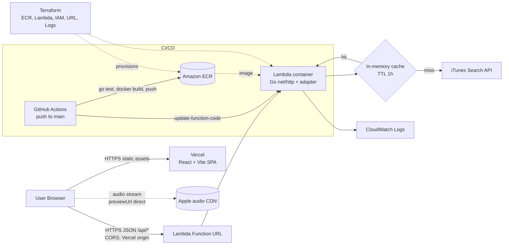
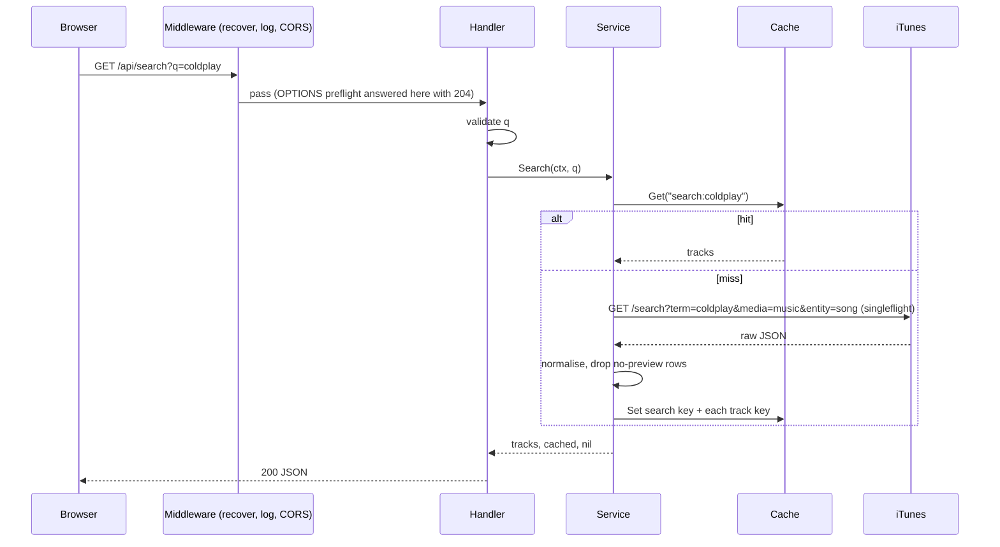
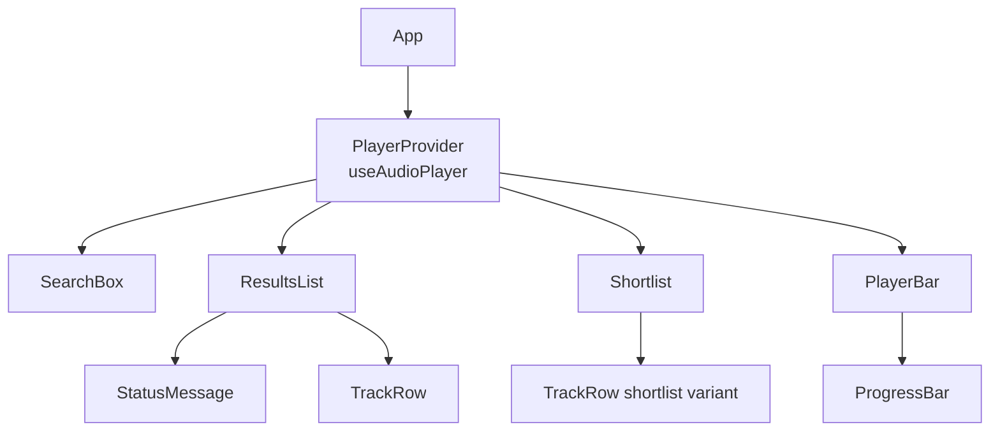
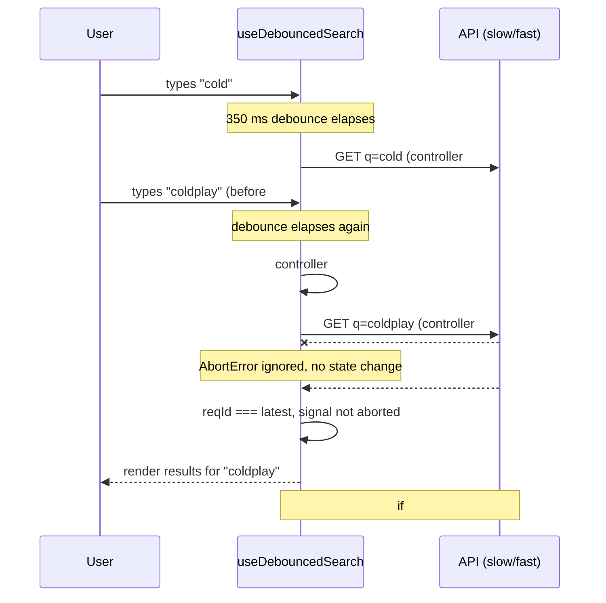

# Audio Preview Board – Design

Search iTunes tracks, build a shortlist, play 30-second previews. React frontend on Vercel, Go backend on AWS Lambda, no database.

## 1. High-level architecture



Key points:
- The browser only calls our API for data; only the audio bytes come straight from Apple's CDN (allowed by the brief).
- The same `http.Handler` runs as a normal local server (`go run`) or on Lambda, selected at startup by whether `AWS_LAMBDA_RUNTIME_API` is set.
- Lambda caveat: the cache lives per warm execution environment. Cold starts or parallel environments start with an empty cache. This is acceptable here; see "Next steps" in the README.

## 2. Data model

There is no database. These are the entities that move through the system.

```mermaid
classDiagram
    class Track {
      +int64 id
      +string name
      +string artist
      +string album
      +string artworkUrl
      +int durationMs
      +string previewUrl
      +string genre
      +string releaseDate
    }
    class CacheEntry~T~ {
      +string key
      +T value
      +time expiresAt
    }
    class ShortlistItem {
      +Track track
      +number addedAt
    }
    CacheEntry "1" o-- "*" Track : search entry holds a list; track entry holds one
    ShortlistItem "1" *-- "1" Track : snapshot copy
```

- **Track** – normalised API response (backend `internal/model`, mirrored by a TS type). iTunes fields are renamed (`trackId`→`id`, `trackName`→`name`, `artistName`→`artist`, `collectionName`→`album`, `trackTimeMillis`→`durationMs`). `artworkUrl` is upgraded from the 100px URL to 300px by rewriting `100x100bb` → `300x300bb`. Rows without a `previewUrl` are dropped.
- **CacheEntry** – server only. Keys: `search:<trimmed lowercased query>` and `track:<id>`. Search results also seed the `track:<id>` entries, so a following `/api/tracks/{id}` is normally a hit.
- **ShortlistItem** – browser only, `localStorage["shortlist.v1"]` as an ordered JSON array. Array order is the user's order. A full Track snapshot is stored so the shortlist renders and plays without any network call.

## 3. API

Base URL: `https://<function-url>` (local: `http://localhost:8080`). All responses are `application/json; charset=utf-8`.

### GET /api/search

| Param | In | Required | Notes |
|---|---|---|---|
| `q` | query | yes | 1–100 chars after trimming. Upstream call is fixed to `entity=song&limit=25` |

```json
{
  "query": "coldplay",
  "count": 2,
  "cached": true,
  "results": [
    {
      "id": 1122823236,
      "name": "Yellow",
      "artist": "Coldplay",
      "album": "Parachutes",
      "artworkUrl": "https://is1-ssl.mzstatic.com/image/thumb/.../300x300bb.jpg",
      "durationMs": 269000,
      "previewUrl": "https://audio-ssl.itunes.apple.com/.../preview.m4a",
      "genre": "Alternative",
      "releaseDate": "2000-07-10T07:00:00Z"
    }
  ]
}
```

An empty result is `200` with `"count": 0, "results": []` (never `null`).

### GET /api/tracks/{id}

`id` – path, positive integer (iTunes `trackId`). Success returns a single Track object (shape above) plus `"cached": bool`.

### GET /api/health

`200 {"status":"ok"}`. Does not touch iTunes or the cache.

### Errors

All errors use one body: `{"error": {"code": "invalid_query", "message": "q is required"}}`.

| Status | code | When |
|---|---|---|
| 400 | `invalid_query` | missing/blank/too long `q` |
| 400 | `invalid_id` | `{id}` is non-numeric or not positive |
| 404 | `not_found` | track id unknown to iTunes |
| 405 | `method_not_allowed` | non-GET |
| 502 | `upstream_error` | iTunes returned 5xx/invalid JSON |
| 503 | `upstream_unavailable` | iTunes rate-limited (403/429), timed out or unreachable. Adds `Retry-After: 30` |
| 500 | `internal` | unexpected / recovered panic |

Errors are never cached (so a rate-limit blip does not stick for an hour).

### Caching behaviour

- TTL from `CACHE_TTL` (Go duration, default `1h`). Expired entries are treated as misses and removed lazily on read; a background janitor sweeps every few minutes so memory is bounded.
- Query is normalised (trim + lowercase) before keying, so `Coldplay` and ` coldplay ` share an entry. The normalised form is also what is sent upstream.
- Concurrent identical misses are collapsed with `singleflight`, so one user typing quickly cannot burn the ~20 req/min iTunes budget.
- Responses carry `Cache-Control: public, max-age=60` and the body has `"cached"` for debugging.
- Max entries cap (e.g. 1000); when exceeded, expired entries are evicted first, then the oldest-expiring entry.

## 4. Low-level design

### 4.1 Backend

```
backend/
├── cmd/api/main.go            # wiring, env config, local server vs Lambda adapter
├── internal/
│   ├── config/config.go       # PORT, CACHE_TTL, ALLOWED_ORIGIN, ITUNES_BASE_URL
│   ├── model/track.go         # Track, SearchResponse, ErrorBody
│   ├── itunes/client.go       # HTTP client, normalisation
│   ├── cache/cache.go         # generic TTL cache
│   ├── service/music.go       # cache + client orchestration (singleflight)
│   └── httpapi/
│       ├── router.go          # ServeMux routes + middleware chain
│       ├── handlers.go        # search, track, health
│       ├── middleware.go      # CORS, recover, logging
│       └── errors.go          # error -> status/code mapping
├── Dockerfile
└── go.mod
```

Key types and interfaces (consumer-defined, so tests can fake them):

```go
// model
type Track struct { ID int64; Name, Artist, Album, ArtworkURL string; DurationMs int; PreviewURL, Genre, ReleaseDate string }

// itunes
type Client interface {
    Search(ctx context.Context, term string) ([]model.Track, error) // entity=song, limit=25, no-preview rows dropped
    Lookup(ctx context.Context, id int64) (model.Track, error) // ErrNotFound if empty
}
var ErrNotFound, ErrRateLimited = errors.New(...), errors.New(...)
type UpstreamError struct{ Status int; Err error }

// cache
type Cache[V any] struct { mu sync.RWMutex; items map[string]entry[V]; ttl time.Duration; now func() time.Time }
func (c *Cache[V]) Get(key string) (V, bool)
func (c *Cache[V]) Set(key string, v V)

// service
type Service struct { client itunes.Client; search *cache.Cache[[]model.Track]; tracks *cache.Cache[model.Track]; sf singleflight.Group }
func (s *Service) Search(ctx, q string) (tracks []model.Track, cached bool, err error)
func (s *Service) Track(ctx, id int64) (model.Track, bool, error)
```

Request flow (search):



Error handling:
- Sentinel errors (`ErrNotFound`, `ErrRateLimited`) plus a wrapped `UpstreamError`; handlers map them in one place (`errors.go`) with `errors.Is/As`. Internals are logged, clients only get the stable `code` and a safe message.
- The iTunes client uses its own `http.Client{Timeout: 5s}` and passes the request context, so a disconnected user cancels the upstream call. Response body is size-limited (`io.LimitReader`, 2 MB) and always closed.
- `recover` middleware turns panics into a 500 `internal`.
- Server: `ReadHeaderTimeout`, `ReadTimeout`, `WriteTimeout`, `IdleTimeout` set; graceful shutdown on SIGTERM when running locally.
- Lambda: function timeout 10s, comfortably above the 5s upstream timeout.

Concurrency safety:
- Cache uses `sync.RWMutex`: `Get` takes `RLock`; expired entries are removed under a separate write lock (re-checked after upgrading). `Set` takes the write lock.
- Cached slices are treated as immutable; handlers never mutate them (return a copy if limiting).
- `singleflight.Group` dedupes concurrent misses per key.
- Clock injected (`now func() time.Time`) so TTL tests do not sleep. Tests run with `-race`.

CORS: middleware reads `ALLOWED_ORIGIN` (e.g. `https://audio-board.vercel.app`; `*` only for local dev), sets `Access-Control-Allow-Origin`, `Allow-Methods: GET, OPTIONS`, `Allow-Headers: Content-Type`, `Vary: Origin`, and answers preflight with 204. On Lambda this is done in code (not the Function URL CORS config) so local and cloud behave identically.

### 4.2 Frontend

Stack: React 18 + Vite + TypeScript, plain CSS, no state library (the state is small and split by owner).

```
frontend/src/
├── api/client.ts              # searchTracks(q, signal), typed fetch + ApiError
├── types.ts                   # Track, SearchResponse
├── hooks/
│   ├── useDebouncedSearch.ts
│   ├── useShortlist.ts
│   └── useAudioPlayer.ts
├── context/PlayerContext.tsx  # exposes the single player to any component
├── components/
│   ├── SearchBox.tsx
│   ├── ResultsList.tsx        # handles loading / empty / error / idle
│   ├── TrackRow.tsx           # artwork, title, artist, duration, play + add/remove
│   ├── Shortlist.tsx          # reorderable list
│   ├── PlayerBar.tsx          # now-playing + seekable progress
│   ├── ProgressBar.tsx        # role="slider"
│   └── StatusMessage.tsx      # loading / empty / error with retry
├── utils/formatTime.ts
└── App.tsx
```

Component tree:



`App` renders `PlayerProvider` around a `Board` component. `Board` owns the **search state** (via `useDebouncedSearch`) and **shortlist state** (via `useShortlist`) and passes them down as props; only the player is in context because it is needed by rows, shortlist and the bar. `Board` is the layer that wires them together, e.g. removing the playing track calls `player.stop()` first.

State management:

| State | Owner | Shape |
|---|---|---|
| Search | `useDebouncedSearch` | `{query, status: 'idle'\|'loading'\|'success'\|'error', results, error}` |
| Shortlist | `useShortlist` | `Track[]`, mirrored to `localStorage` |
| Player | `useAudioPlayer` | `{currentTrack, isPlaying, currentTime, duration}` |

Hooks:
- `useDebouncedSearch(delay = 350)` – returns `{query, setQuery, status, results, error, retry}`. Trims query; blank query resets to `idle` without a request. On each debounced change it aborts the previous `AbortController`, starts a new request, and ignores `AbortError`. See the sequence diagram below.
- `useShortlist()` – lazy-initialises from `localStorage` inside try/catch (corrupt JSON or blocked storage falls back to `[]`), validates shape, writes in an effect on change. Exposes `add` (ignores duplicates), `remove(id)`, `move(from, to)` and `has(id)`. Listens to the `storage` event to sync tabs. Reorder UI: up/down buttons only (keyboard friendly). Drag and drop is listed under "next steps" in the README.
- `useAudioPlayer()` – creates exactly one `HTMLAudioElement` in a ref (single instance is what guarantees "only one track plays at a time"). `play(track)`: if same track, toggle; otherwise `pause()`, set `src`, `play()`. Subscribes to `timeupdate`, `loadedmetadata`, `ended`, `pause`, `play`, `error`, cleaning up on unmount. `seek(seconds)` sets `currentTime`. `stop()` pauses and clears `src`/`currentTrack`. `useShortlist.remove` is wrapped in `App` so that removing the currently playing track calls `player.stop()` first, which gives the "stops cleanly on removal" behaviour. `play()` rejections (autoplay policy, bad URL) surface as a player error state, not an unhandled promise.

Progress bar and accessibility:
- `ProgressBar` is `role="slider"` with `aria-label="Seek"`, `aria-valuemin/max/now`, `aria-valuetext="0:12 of 0:30"`, `tabIndex=0`. Pointer events with `setPointerCapture` support click and drag; Left/Right = ±5s, Home/End = start/end. During a drag the displayed value follows the pointer and the audio seeks on release (avoids stutter).
- Play buttons: `aria-label="Play Yellow by Coldplay"`, `aria-pressed` reflects playing state. Add/remove/move buttons have descriptive labels. Visible `:focus-visible` outline on every control.
- Result/status area is `aria-live="polite"` so "Loading", "No results for X" and errors are announced. Error state is `role="alert"`. Shortlist moves announce via the live region ("Yellow moved to position 2").

### Preventing stale search responses

Two layers: the `AbortController` cancels the old request, and a request-id check protects against any response that still slips through (e.g. already resolved when abort fires).



The effect cleanup also aborts on unmount, and React 18 StrictMode double-invocation is safe because each run aborts the previous one.

## 5. Configuration summary

| Name | Where | Default | Purpose |
|---|---|---|---|
| `PORT` | backend | `8080` | local listen port (ignored on Lambda) |
| `CACHE_TTL` | backend / Terraform `cache_ttl` | `1h` | cache lifetime |
| `ALLOWED_ORIGIN` | backend / Terraform `allowed_origin` | `http://localhost:5173` | CORS |
| `VITE_API_URL` | frontend | `http://localhost:8080` | API base URL |
| `aws_region`, `environment`, `app_port` | Terraform | `ap-south-1`, `prod`, `8080` | infra parameters |
